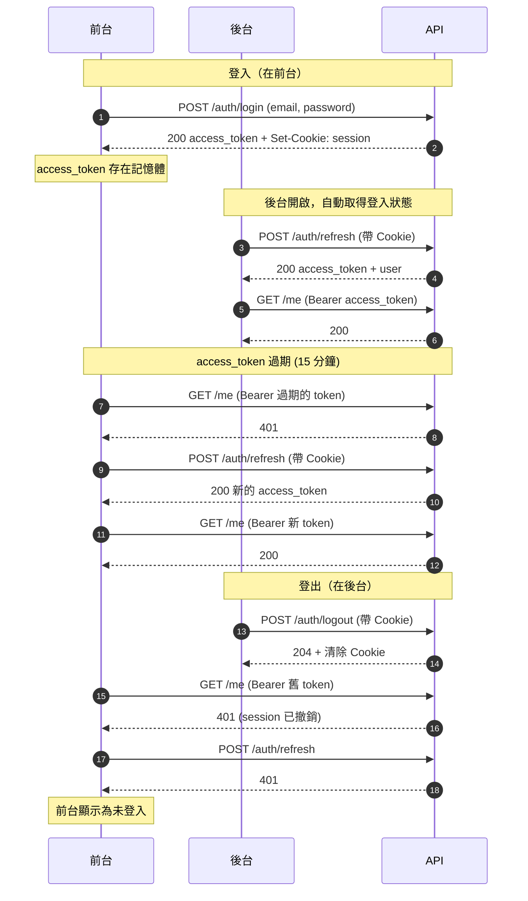
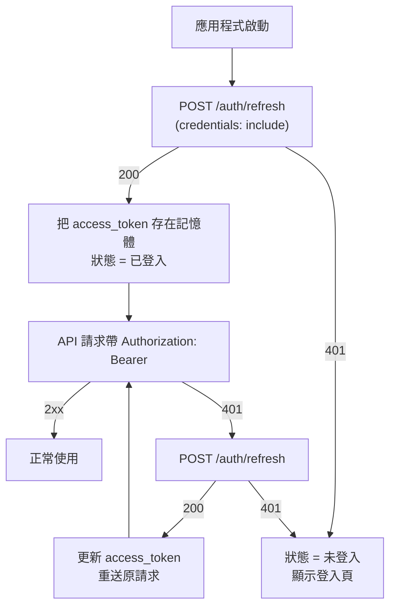

# 2026-10-22 Frontend Changelog

## 新功能

### 前台與後台共享登入狀態

登入現在會建立伺服器端 session，並以 Cookie 在所有共用此 API 的前端之間共享。

- `POST /auth/login` 除了回傳 `access_token`，還會設定 `session` Cookie（production 為 `__Host-session`；HttpOnly、Secure、SameSite=Lax、不含 Domain，有效 30 天）。
- `POST /auth/refresh`：以 Cookie 換取新的 `access_token` 與 `user`（格式同登入）。沒有 Cookie 或 session 無效時回傳 `401`。
- `POST /auth/logout`：撤銷 session 並清除 Cookie，回傳 `204`。可重複呼叫。

流程總覽（`前台`、`後台` 是同一個瀏覽器上的兩個前端，共用同一個 session Cookie）：

前端啟動時的判斷流程：

前端整合方式：

1. 所有對 API 的請求（至少 `/auth/*`）都要帶 `credentials: "include"`。
2. 應用程式啟動時呼叫 `POST /auth/refresh`：成功即為已登入；`401` 即為未登入。
3. `access_token` 仍以 `Authorization: Bearer` 帶上，建議只存在記憶體；到期（預設 15 分鐘）或收到 `401` 時重新呼叫 `/auth/refresh`，若仍 `401` 則視為已登出。
4. 登出時呼叫 `POST /auth/logout`。其他前端的 Access Token 會立即失效，下次 API 請求回傳 `401`，refresh 也會失敗。
5. 前後台必須都在 `gravitycat.tw` 底下（同站），Cookie 才會在 `fetch` 中送出；前後台的 Origin 需列入後端的 `PROD_ORIGINS`。

## 行為變更

- 既有的 Access Token（未綁定 session）全部失效，部署後使用者需重新登入一次。
- `DELETE /pickup-groups/{id}`：團主（創建者）現在可以刪除自己的團，不再限系統管理員；其他人回傳 `403`。團仍有報名紀錄時回傳 `409`，須先取消團。
