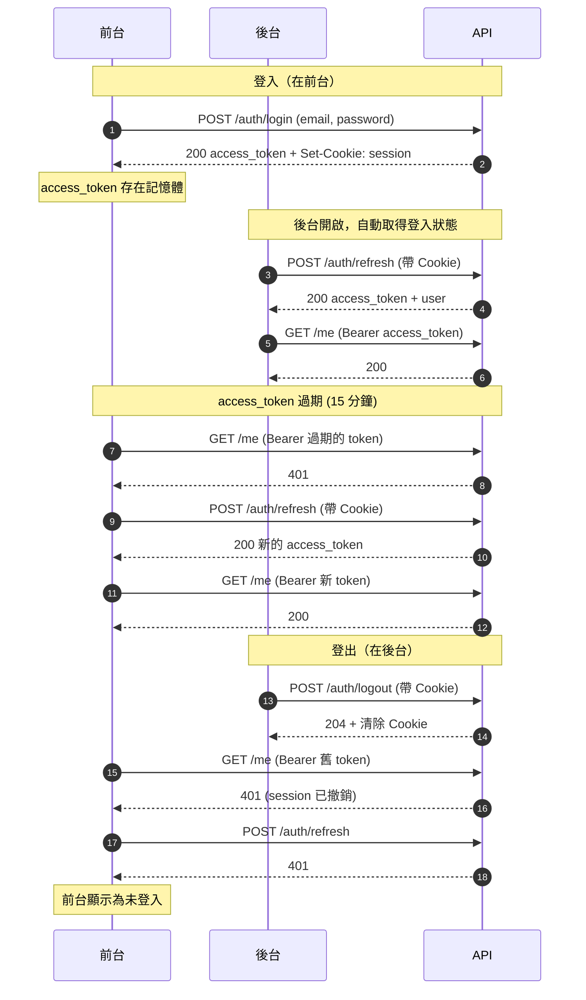
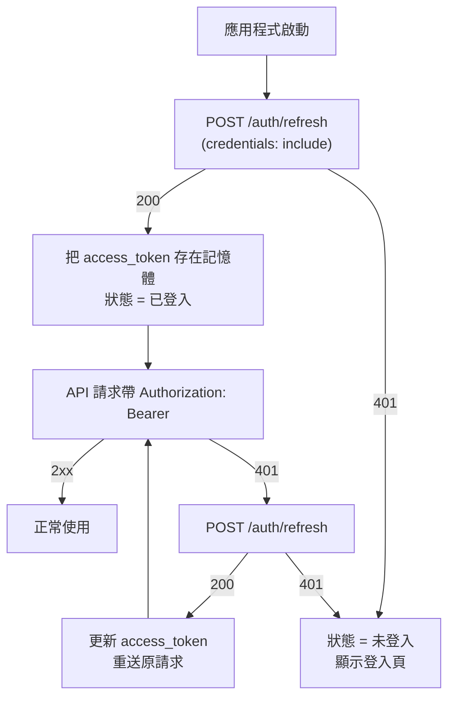
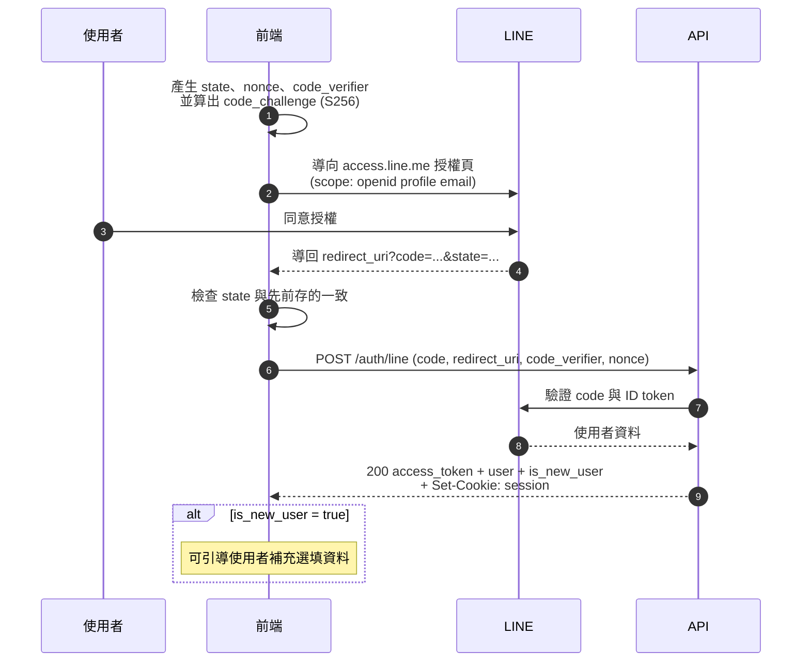

# 2026-10-25 Frontend Changelog

本份整合 10/22 與 10/25 兩次更新：登入改為伺服器端 session 並在前台與後台之間共享（10/22），以及新增 LINE 登入／註冊（10/25）。登入相關的改動請以本份為準。

## 重點摘要

- 登入（不論 email/密碼或 LINE）都會建立伺服器端 session，並設定 `session` Cookie；所有共用此 API 的前端因此共享登入狀態。
- 前端啟動時呼叫 `POST /auth/refresh` 判斷是否已登入，不再自己保存登入資訊。
- 新增 LINE 登入／註冊：第一次登入自動建立帳號，不需填 email 和密碼，名稱與大頭貼自動帶入。
- 使用者的 `email` 現在可能是 `null`。
- **部署後所有使用者需重新登入一次**（舊的 Access Token 全部失效）。

## 登入與 session

### API 一覽

| 端點 | 說明 |
| --- | --- |
| `POST /auth/login` | email/密碼登入。回傳 `access_token`、`user`，並設定 session Cookie |
| `POST /auth/line` | LINE 登入或註冊（見下一節）。回傳格式同上，另有 `is_new_user` |
| `POST /auth/refresh` | 以 Cookie 換取新的 `access_token` 與 `user`（格式同登入）。沒有 Cookie 或 session 無效回傳 `401` |
| `POST /auth/logout` | 撤銷 session 並清除 Cookie，回傳 `204`，可重複呼叫 |

Cookie 為 `session`（production 為 `__Host-session`；HttpOnly、Secure、SameSite=Lax、不含 Domain，有效 30 天）。

### 流程

流程總覽（`前台`、`後台` 是同一個瀏覽器上的兩個前端，共用同一個 session Cookie；登入也可以換成 LINE 登入，後續流程相同）：



前端啟動時的判斷流程：



### 前端整合方式

1. 所有對 API 的請求（至少 `/auth/*`）都要帶 `credentials: "include"`。
2. 應用程式啟動時呼叫 `POST /auth/refresh`：成功即為已登入；`401` 即為未登入。
3. `access_token` 仍以 `Authorization: Bearer` 帶上，建議只存在記憶體；到期（預設 15 分鐘）或收到 `401` 時重新呼叫 `/auth/refresh`，若仍 `401` 則視為已登出。
4. 登出時呼叫 `POST /auth/logout`。其他前端的 Access Token 會立即失效，下次 API 請求回傳 `401`，refresh 也會失敗。
5. 前後台必須都在 `gravitycat.tw` 底下（同站），Cookie 才會在 `fetch` 中送出；前後台的 Origin 需列入後端的 `PROD_ORIGINS`。

## LINE 登入／註冊

與 email/密碼並行。第一次以 LINE 登入會自動建立帳號，使用者不用另外填 email 和密碼。

### `POST /auth/line`

request body：

```json
{
  "code": "LINE 回傳的 authorization code",
  "redirect_uri": "授權時使用的 redirect URI",
  "code_verifier": "PKCE code verifier（43-128 字元）",
  "nonce": "授權時送出的 nonce"
}
```

回應同 `POST /auth/login`（`access_token`、`user`，並設定 session Cookie），另外多一個 `is_new_user`：`true` 表示這次建立了新帳號，前端可據此引導使用者補充選填資料。

| 狀態碼 | 情況 |
| --- | --- |
| `400` | 欄位缺漏，或 `redirect_uri` 不在後端允許清單內 |
| `401` | LINE 授權失敗（code 無效或已使用、nonce 不符），或帳號已停用 |
| `404` | 後端未啟用 LINE 登入 |
| `502` | 無法連線到 LINE |

### 授權流程



### 前端整合方式

1. 授權網址為 `https://access.line.me/oauth2/v2.1/authorize`，參數：`response_type=code`、`client_id`（LINE Channel ID）、`redirect_uri`、`state`、`scope=openid profile email`、`nonce`、`code_challenge`、`code_challenge_method=S256`。
2. `state`、`nonce`、`code_verifier` 每次授權都要重新產生，並存在 `sessionStorage`，回到 callback 頁時取出使用。`state` 必須由前端自己比對，不一致就中止。
3. `redirect_uri` 必須與後端環境變數 `LINE_REDIRECT_URIS` 的設定完全一致，也要與 LINE Console 登記的 callback URL 一致，否則回傳 `400`。新增前端網域時需請後端加入。
4. 登入成功後的處理與一般登入相同：`access_token` 存在記憶體，並依上面的 `/auth/refresh` 流程維持登入狀態。
5. 後端未設定 LINE 時 `POST /auth/line` 回傳 `404`，前端可據此隱藏 LINE 登入按鈕。

### 新帳號自動帶入的資料

| 欄位 | 內容 |
| --- | --- |
| `display_name` | LINE 顯示名稱（最長 50 字；空白時為 `LINE user`） |
| `username` | 系統產生，`l` 開頭共 15 字元的隨機小寫英數字，目前不可修改 |
| `avatar` | LINE 大頭貼（下載失敗時為 `null`） |
| `email` | 使用者授權 email 且 LINE 有提供時才有，否則為 `null` |
| `phone`、`gender`、`birth_date` | 空白，使用者之後可自行在 `PATCH /me` 填寫 |

相同 email 不會自動合併帳號：若 LINE 提供的 email 已被其他帳號使用，新帳號的 `email` 會是 `null`。要使用既有帳號請先以 email 登入，再綁定 LINE。

## 帳號綁定與密碼

| 端點 | 說明 |
| --- | --- |
| `POST /me/identities/line` | 已登入的使用者綁定 LINE。body 同 `POST /auth/line`，成功回傳 `{ "user": ... }` |
| `DELETE /me/identities/line` | 解除 LINE 綁定，回傳 `204`；未綁定時回傳 `404` |
| `PUT /me/password` | 讓沒有密碼的帳號補設密碼，回傳 `204` |

規則：

- 一個帳號只能綁一個 LINE，一個 LINE 也只能綁一個帳號。重複綁定、或該 LINE 已被其他帳號綁定時回傳 `409`。
- 至少要保留一種登入方式。只有 LINE 而沒有密碼的帳號呼叫 `DELETE /me/identities/line` 會回傳 `409`，須先設定密碼。
- `PUT /me/password` 的 body 為 `{ "password": "...", "email": "..." }`。不需要舊密碼，每個帳號只能設定一次（已有密碼回傳 `409`）。帳號沒有 email 時 `email` 為必填；已有 email 時會忽略此欄位。email 已被其他帳號使用時回傳 `409`。
- 以 LINE 註冊的帳號用 email/密碼登入會回傳 `401`（`invalid email or password`），與密碼錯誤的訊息相同。

建議在帳號設定頁依使用者物件的新欄位顯示狀態：`linked_providers` 含 `"line"` 時顯示「已綁定 LINE」，`has_password` 為 `false` 時提供「設定密碼」。

## 使用者物件的變更

所有回傳使用者的地方（`/me`、`/users`、`/users/{id}`、`/auth/login`、`/auth/refresh`、`/auth/line`）：

- 新增 `has_password`（boolean）：是否可用 email/密碼登入。
- 新增 `linked_providers`（string 陣列）：已綁定的外部登入，目前只會出現 `"line"`。
- `email` 可能是 `null`（以 LINE 註冊且未提供 email 的帳號）。組織與場館的 managers／members 清單中的 `email` 也一樣。前端顯示或使用 `email` 前需先判斷是否為 `null`，沒有 email 的帳號請改顯示 `username`。

## 其他變更

### 組織新增成員可用 username

`POST /organizations/{id}/members` 的 body 現在可以傳 `email` 或 `username`，兩者擇一：

```json
{ "username": "some_user" }
```

兩個都傳或都不傳回傳 `400`；找不到使用者回傳 `404`。以 LINE 註冊且沒有 email 的使用者只能用 `username` 加入。原本傳 `email` 的呼叫方式不變。

### 團主可刪除自己的臨打團

`DELETE /pickup-groups/{id}`：團主（創建者）現在可以刪除自己的團，不再限系統管理員；其他人回傳 `403`。團仍有報名紀錄時回傳 `409`，須先取消團。

## 部署注意

- 既有的 Access Token（未綁定 session）全部失效，部署後使用者需重新登入一次。
- 要啟用 LINE 登入，後端需設定 `LINE_CHANNEL_ID`、`LINE_CHANNEL_SECRET`、`LINE_REDIRECT_URIS`，並在 LINE Console 登記 callback URL。要取得使用者 email 還需另外申請 Email address permission；沒有 email 的帳號仍可正常註冊。

## 前端檢查清單

- [ ] 所有 API 請求帶 `credentials: "include"`
- [ ] 啟動時呼叫 `POST /auth/refresh` 判斷登入狀態
- [ ] 收到 `401` 時先 refresh 再重送，仍失敗才視為登出
- [ ] 登出呼叫 `POST /auth/logout`
- [ ] 新增 LINE 登入按鈕與 callback 頁（`state`、`nonce`、PKCE），`404` 時隱藏按鈕
- [ ] 處理 `email` 為 `null` 的顯示
- [ ] 帳號設定頁：綁定／解除 LINE、設定密碼
- [ ] 組織新增成員支援 `username`
